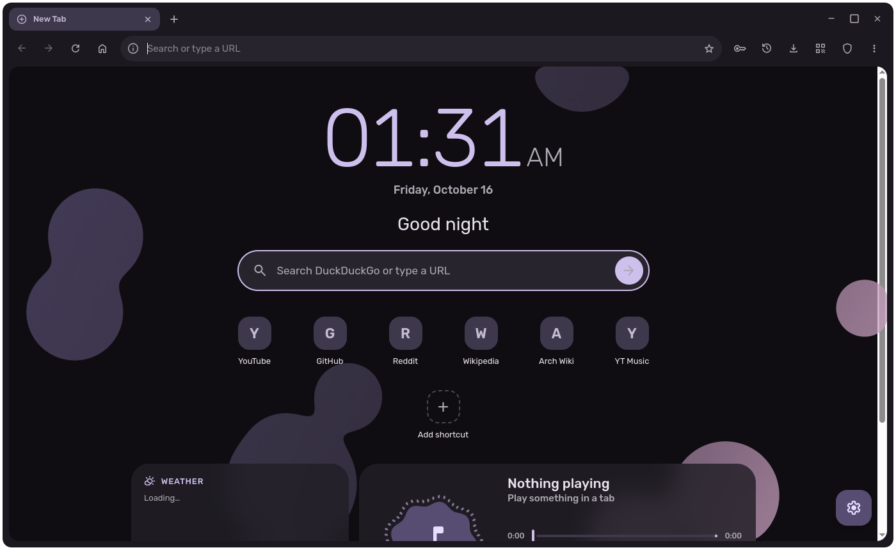
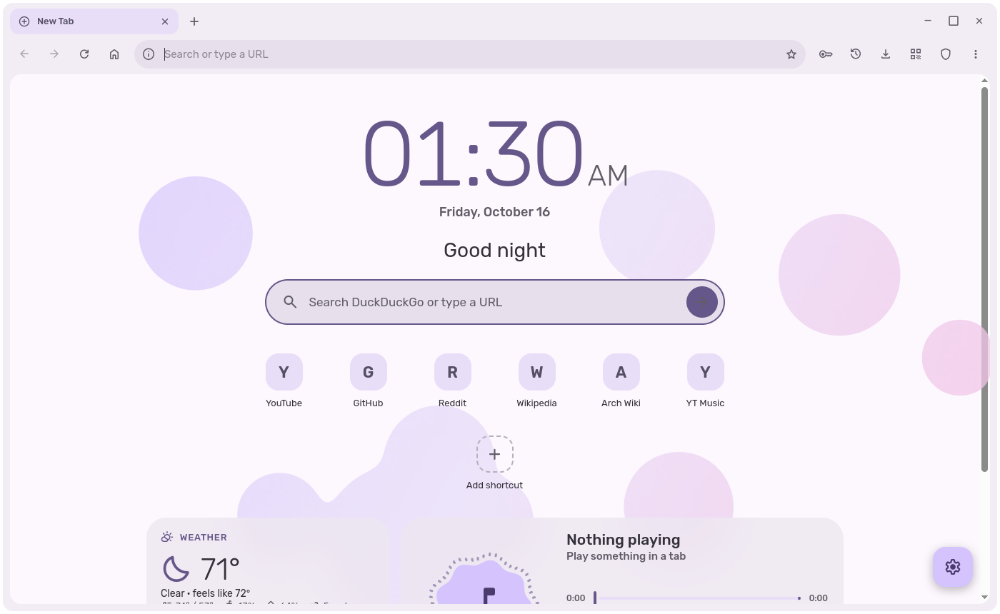
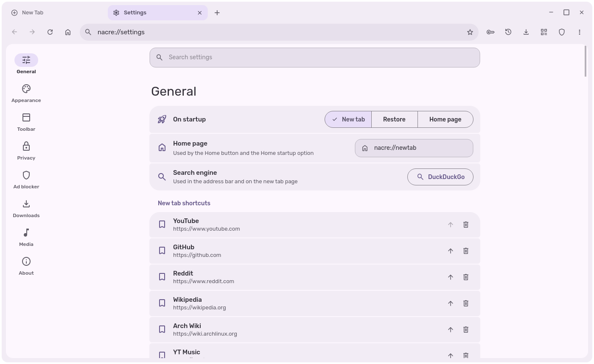
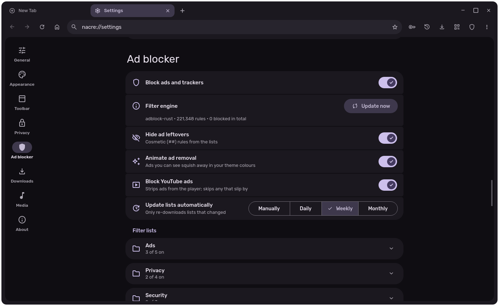
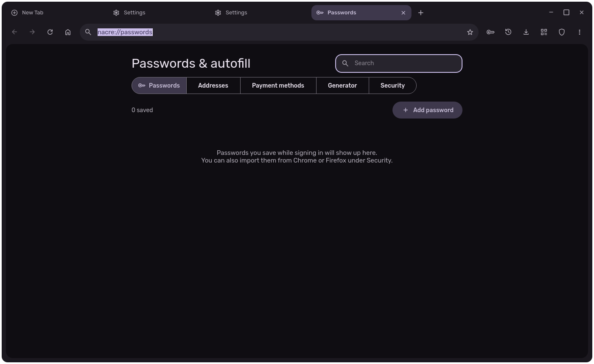

# Nacre

A Material You / M3 Expressive web browser built on PyQt6 + QtWebEngine (Chromium).



| | |
|---|---|
|  |  |
|  |  |

## Install from source

**Linux** (developed on Arch / KDE Plasma, Wayland):
```bash
git clone https://github.com/Domslayer342/Nacre && cd Nacre
./scripts/build.sh --desktop        # .venv + packages + fonts + app-menu entry
.venv/bin/python run.py
```
Use `--system` to reuse distro PyQt6 packages (Arch: `python-pyqt6-webengine`) instead of the pip wheels.

**Windows 10/11** (PowerShell, no admin needed):
```powershell
irm https://raw.githubusercontent.com/Domslayer342/Nacre/main/scripts/install-windows.ps1 | iex
```
or from a clone: `powershell -ExecutionPolicy Bypass -File scripts\install-windows.ps1 -Desktop`.
It installs Python 3.13 with winget if needed, puts Nacre in `%LOCALAPPDATA%\Programs\Nacre` and adds a Start
menu shortcut. Run it again to update. On Windows Nacre shows up under Settings → Apps → Default apps, media keys control the playing tab, the password prompt checks your Windows password, installed web apps go in the Start menu under "Nacre Apps", and Widevine comes from an installed Chrome/Edge. Windows is less tested than Linux.

Needs Python 3.12+, PyQt6 + PyQt6-WebEngine (6.8+), `materialyoucolor` and `cryptography` (see
`requirements.txt`). `qrcode` and `adblock` (adblock-rust, Linux x86_64) are bundled in `nacre/_vendor/`; the
scripts download the **Rubik** and **Material Symbols Rounded** fonts into `nacre/fonts/`.

**Widevine (Netflix, Hulu, Spotify…):** Nacre uses an installed CDM (Chromium, Chrome, Brave, Firefox, or its own).
If none is found, Settings → Media → Install downloads Google's module (via Mozilla's update service, SHA-512
checked). Google's license doesn't allow bundling it.

## Features
- **Colour that follows the site.** Seeds from the page's `theme-color` or favicon, or from the KDE accent,
  a preset palette or a custom colour. Any scheme variant and contrast level, light, dark or system mode, all
  animated. The new tab page gets the same colours.
- **Frameless window** (optional system title bar), animated tab strip with drag-to-reorder, audio/mute badges,
  the page in a rounded floating card, pill omnibox with load-progress wash, history completion and a bookmark star.
- **Toolbar** customisable like Chrome's list (Settings → Toolbar); unfinished items show "coming soon".
- **Media flyout:** the artwork spins in a scalloped "cookie" while the image stays upright, with a visualizer
  riding the edge, wavy progress, and play/skip/repeat controls for any tab.
- **Discord Rich Presence** through arRPC (Vesktop/Equibop) or the Discord app. About 25 media sites get full
  info: art (taken from the YouTube video ID), linked title and creator, buttons, a real progress bar and a paused
  state. Each site can have its own app ID, so it shows as "Watching YouTube". Optionally every other tab is
  reported as browsing (site or page title, with the site's favicon). An application ID from
  discord.com/developers is required; pasting one turns RPC on.
- **Media keys and Plasma media controls (MPRIS).** The visualizer uses the tab's real audio, bass to treble.
- **Ad blocking:** grouped filter lists (Ads, Privacy, Security, Annoyances, Hosts/DNS, Fixes) plus your own
  links, cosmetic hiding with an animated "squish away" removal (never touches video players), a built-in YouTube ad defuser, per-site pause, and DNT/GPC.
  Lists refresh with `If-Modified-Since` and are parsed off the UI thread.
- **Downloads:** sent to AB Download Manager (`localhost:15151`) with cookies when it's running, otherwise
  handled by the built-in downloader (speed, ETA, wavy progress).
- **Light on a slow connection:** restored tabs load only when opened, background tabs freeze and then unload,
  1 GB disk cache, QUIC, and an optional Save-Data header.
- **Passwords, addresses and cards** in a built-in encrypted vault (`nacre://passwords`). No KDE Wallet or other
  service is needed. It uses AES-256-GCM under either a device key or an optional master password (scrypt;
  auto-lock). It offers to save logins, fills them on load or from a suggestion menu, suggests strong passwords on
  sign-up forms, fills addresses and cards (CVC never stored), and has a generator (random or passphrase) with a
  wavy strength meter, health checks for weak and reused passwords, clipboard auto-clear, and Chrome/Firefox
  CSV import/export.
- **Wavy progress everywhere:** omnibox loading line, wavy circular spinners and download ring, filter-list update
  bars, download rows, media seek bar.
- **Split view** (Ctrl+Shift+S): a second tab pinned on the right. Swap sides with ⇄; selecting the partner
  tab also swaps.
- **Reading mode** (Alt+R): pulls out the article into a themed overlay with serif toggle, text size and width.
  **Reading list**: save pages for later; unread items come first.
- **Task manager** (Shift+Esc): memory and CPU per tab and Chromium process. Freeze, end process or close.
- Zoom is remembered per site. Page console messages only print with `NACRE_DEBUG=1`.
- **New tab page:** animated backgrounds that react to the cursor (shapes, blobs, particles, waves, dot grid) in your Material You colours, or your own image/GIF with dim and blur. Elements can be added, removed and
  reordered: clock, greeting, search, shortcuts, now playing (controls the playing tab), weather (Open-Meteo),
  notes, reading list, top sites. The ⚙ at the bottom right customizes it.
- **Built-in pages:** `nacre://settings` (with search), `nacre://history` (grouped by day), `nacre://bookmarks`,
  `nacre://downloads`, `nacre://reading`, `nacre://tasks` and `nacre://about`, each searchable.
- **Web apps:** install PWAs (⤓ in the address bar) or create a shortcut to any site (menu). Each gets its own
  window and icon, and a launcher entry; manage them at `nacre://apps`.
- **Site info** (lock icon): connection security, per-site permissions with reset, cookies, ad blocking, zoom,
  saved passwords.
- **Single instance:** links opened from other apps land in the running window. Works as your default browser.
- **Google sign-in fix:** Nacre appears as Firefox only on accounts.google.com, because Google blocks embedded browsers.
- Find bar, link-hover bubble, incognito windows, session restore, full screen, devtools, print, translate,
  and an editable new tab page (hover a tile → ✎, or Settings → General).

## Shortcuts
Ctrl+T/W/Shift+T tabs · Ctrl+Tab · Ctrl+1–9 · Ctrl+L / Alt+D omnibox · Ctrl+R/F5 · Ctrl+F find · Ctrl+D bookmark ·
Ctrl+H history (Ctrl+Shift+H full page) · Ctrl+J downloads · Ctrl+N / Ctrl+Shift+N windows · Ctrl+= / - / 0 zoom · F11 full screen ·
F12 devtools · Ctrl+, settings · Ctrl+M mute · Ctrl+Q quit

## Files
Settings `~/.config/nacre/settings.json`; history, bookmarks, session and the web profile in
`~/.local/share/nacre/`; filter lists and the web cache in `~/.cache/nacre/`. Native crashes are logged to
`~/.cache/nacre/crash.log`. On Windows all of it lives in `%LOCALAPPDATA%\Nacre\`.

Dev hook: `NACRE_SCRIPT=file.py python run.py` runs a script with `ctx` and `app` in scope after startup
(used for automated screenshots). Point `XDG_CONFIG_HOME`, `XDG_DATA_HOME` and `XDG_CACHE_HOME` somewhere else
to test against a throwaway profile.
